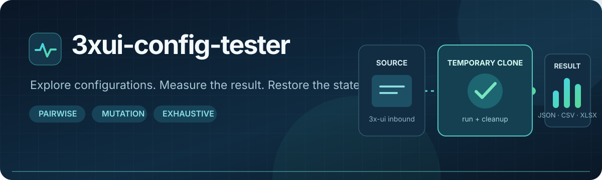

<p align="center">
  <a href="README.md">English</a> · <a href="README.ru_RU.md">Русский</a>
</p>

<p align="center">
  
</p>

<p align="center">
  <a href="https://github.com/OctoberIsTired/3xui-config-tester/actions/workflows/tests.yml"></a>
  
</p>

# 3xui-config-tester

`3xui-config-tester` проверяет варианты конфигурации inbound в 3x-ui/Xray. Он читает
OpenAPI работающей панели, получает исходный inbound, создаёт временный клон
и запускает локальный Xray-клиент для измерений. Результат каждого повтора
записывается в журнал, чтобы эксперимент можно было продолжить.

Проект проверен с 3x-ui v3.8.0 и Xray v26.9.9. Совместимость конкретной панели
проверяется перед изменением inbound: если её OpenAPI не содержит нужных
операций, запуск завершается до каких-либо изменений.

## Навигация

- [Требования](#требования) — что нужно до первого запуска.
- [Быстрый старт](#быстрый-старт) — минимум действий до preview.
- [Пошаговая инструкция](#пошаговая-инструкция) — от пустой папки до полного плана.
- [SSH-туннель к API 3x-ui](#ssh-туннель-к-api-3x-ui) — доступ к панели на сервере.
- [Web UI](#web-ui) — единственный способ запуска: настройка и управление в браузере.
- [Адаптивный поиск и порт 9443](#адаптивный-поиск-и-порт-9443) — цели, уровни проверки, бюджеты и маршрут.
- [Конфигурация](#конфигурация) — ключевые поля и параметры.
- [Результаты и восстановление](#результаты-и-восстановление) — файлы, остановка и отчёты.
- [Частые проблемы](#частые-проблемы) — таблица симптомов.
- [ARCHITECTURE.md](ARCHITECTURE.md) — компоненты и жизненный цикл.

## Возможности

- Стратегии подбора: `adaptive`, `mutation`, `pairwise` и `exhaustive`, с лимитом
  `testing.max_combinations`.
- Независимый поиск совместных изменений при нерабочем baseline, отдельное
  подтверждение в новых клиентских сессиях и бюджеты времени, запросов и трафика.
- Параметры inbound и локального Xray-клиента, условия и нормализация
  неактивных параметров.
- Проверка клиентского конфига локальным Xray (`run -test`) до изменения
  inbound и до попытки подключения: несовместимые сочетания получают статус
  `SKIPPED` с кодом `client_config_*`.
- Список REALITY-целей (`testing.reality.candidates_file`), проверяемых со
  стороны панели.
- Измерения TCP, ICMP, HTTP latency/p95, стабильности и, по желанию,
  ограниченной загрузки.
- Режим `clone` по умолчанию; режим `existing` требует `allow_existing: true`
  и сохраняет снимок исходного inbound для восстановления.
- Durable-журнал и CSV/JSON/XLSX-экспорт.
- Управление только через локальный Web UI, привязанный к `127.0.0.1`.

## Требования

- Git.
- [uv](https://docs.astral.sh/uv/getting-started/installation/), Python 3.12
  или новее.
- Бинарный файл Xray, доступный машине, на которой выполняется тест, —
  не только серверный Xray в составе 3x-ui.
- Сетевой доступ к 3x-ui API и к публичному адресу тестового inbound.
- Учётные данные панели: предпочтительно API token.

Для настоящего теста машина запуска должна иметь доступ к clone inbound. На
практике это обычно Linux-сервер с 3x-ui. Windows подходит для локальной
разработки, preview и управления удалённой панелью, если на нём есть Xray и
маршрут до тестового inbound.

## Быстрый старт

```bash
git clone https://github.com/OctoberIsTired/3xui-config-tester.git
cd 3xui-config-tester
uv run 3xui-config-tester
```

Эта одна команда установит окружение проекта, создаст `configs/local.yaml` из
`configs/example.yaml`, если его нет, и запустит Web UI. Откройте
`http://127.0.0.1:8765` **на той же машине** и заполните на вкладке
«Соединение» `panel.url`, `inbound.source_id`, публичный
`testing.server_address` и `testing.xray_binary` — UI сохранит их в YAML-файл.
Секреты передавайте через переменные окружения (`PANEL_API_TOKEN`);
`configs/local.yaml` игнорируется Git.

Перед реальным тестом проверьте план на вкладке «План поиска» и достижимость
тестового адреса и порта с машины запуска. Конфигурация подставляет переменные
вида `${PANEL_API_TOKEN}` из окружения. Не добавляйте токены и пароли в Git.

```bash
uv run 3xui-config-tester --config configs/local.yaml --port 8765
```

Откройте `http://127.0.0.1:8765` **на той же машине**. Вся настройка, preview
и запуск выполняются в браузере; отдельного CLI-режима у утилиты нет.

## Пошаговая инструкция

Инструкция ведёт от пустой рабочей папки до первого отчёта. Команды
выполняются **на машине с тестером**. Панель 3x-ui и Xray inbound могут работать
на другом сервере.

В примерах замените `panel.example.com`, `vpn.example.com`, ID `4`, порт `2054`
и пути к Xray на свои значения. Сначала используйте режим `clone`: тестер создаёт
временный inbound на отдельном порту, а исходный inbound остаётся без изменений.
Настоящий запуск всё же создаёт, обновляет и удаляет этот временный inbound в
панели и отправляет сетевые запросы.

### 1. Подготовьте панель и сеть

Перед установкой соберите следующие данные:

| Что нужно | Где взять и зачем |
| --- | --- |
| URL API панели | Адрес 3x-ui, доступный с машины тестера, например `https://panel.example.com` или локальный конец SSH-туннеля. Укажите базовый URL, без `/panel/api/...`. |
| API token | Токен для запросов к панели. В конфигурации будет ссылка на переменную окружения, а не сам токен. |
| ID исходного inbound | Число из списка inbound панели. Из него будет создан клон. |
| Адрес Xray сервера | IP или домен, к которому подключится локальный Xray-клиент. Это обычно **не** адрес API панели. |
| Порт для клона | Свободный TCP-порт на сервере с 3x-ui, доступный с машины тестера. Для KCP/mKCP потребуется также UDP. |
| Файл Xray | Исполняемый файл Xray для **машины тестера**, а не только серверный Xray в составе 3x-ui. |

Исходный inbound должен содержать хотя бы одного включённого клиента и использовать `vless`,
`vmess`, `trojan` или `shadowsocks`. Для проверки берётся первый включённый клиент. Убедитесь,
что к выбранному порту ведёт маршрут и его пропускают firewall и правила
провайдера. Preview и загрузка inbound эту доступность не проверяют.

Если API панели слушает только `127.0.0.1` на удалённом сервере, откройте
**отдельный терминал на машине тестера** и оставьте туннель работающим:

```bash
ssh -N -L 2054:127.0.0.1:2054 user@server
```

Первый `2054` — локальный порт машины тестера, второй — порт панели на сервере.
Тогда в YAML используйте `panel.url: "http://127.0.0.1:2054"` либо `https`, если
панель действительно работает по HTTPS. Подробнее — в разделе
[SSH-туннель к API 3x-ui](#ssh-туннель-к-api-3x-ui).

### 2. Установите инструменты

Нужны Git, [uv](https://docs.astral.sh/uv/getting-started/installation/),
Python 3.12+ и Xray. Если Git и uv уже установлены, проверьте их:

```text
git --version
uv --version
```

Установщик uv из [официальной документации](https://docs.astral.sh/uv/getting-started/installation/):

**Linux (bash):**

```bash
curl -LsSf https://astral.sh/uv/install.sh | sh
```

**Windows (PowerShell):**

```powershell
powershell -ExecutionPolicy ByPass -c "irm https://astral.sh/uv/install.ps1 | iex"
```

После установки откройте новый терминал и выполните `uv --version`. Если Python
3.12+ ещё нет, uv может установить его для проекта:

```text
uv python install 3.12
```

Для локального Xray используйте уже установленный исполняемый файл или скачайте
архив для своей ОС и архитектуры из
[официальных выпусков Xray-core](https://github.com/XTLS/Xray-core/releases).
Распакуйте его на **машине тестера**, запомните путь к `xray`/`xray.exe` и
проверьте запуск. Примеры путей ниже нужно заменить на фактические:

```bash
# Linux
/usr/local/x-ui/bin/xray-linux-amd64 version
```

```powershell
# Windows: если архив распакован в .tools/xray внутри проекта
& ".\.tools\xray\xray.exe" version
```

На Linux путь из примера существует только при соответствующей установке
3x-ui. Если тестер запущен на другой машине, перенесите или установите Xray
туда и укажите путь к **локальному** исполняемому файлу. Этот же бинарник
используется для проверки клиентских конфигов в режиме `run -test`.

### 3. Скачайте проект и зависимости

**Linux (bash):**

```bash
git clone https://github.com/OctoberIsTired/3xui-config-tester.git
cd 3xui-config-tester
uv sync
cp configs/example.yaml configs/local.yaml
```

**Windows (PowerShell):**

```powershell
git clone https://github.com/OctoberIsTired/3xui-config-tester.git
Set-Location 3xui-config-tester
uv sync
Copy-Item configs/example.yaml configs/local.yaml
```

Файл `configs/local.yaml` исключён из Git. Команды далее выполняйте из корня
репозитория; `uv run` использует установленное окружение проекта.

### 4. Укажите токен и настройте `configs/local.yaml`

Переменная окружения действует в **текущем терминале**. После открытия нового
терминала установите её снова, прежде чем запускать Web UI.

**Linux (bash):**

```bash
export PANEL_API_TOKEN='ваш-токен'
```

**Windows (PowerShell):**

```powershell
$env:PANEL_API_TOKEN = 'ваш-токен'
```

Откройте `configs/local.yaml` в редакторе и измените существующие поля. Не
заменяйте весь файл фрагментом ниже: в образце также находятся параметры,
тайм-ауты и настройки измерений.

```yaml
panel:
  url: "https://panel.example.com"
  api_token: "${PANEL_API_TOKEN}"
  verify_tls: true

inbound:
  mode: clone
  source_id: 4
  test_port: 24443

testing:
  server_address: "vpn.example.com"
  xray_binary: "/путь/к/локальному/xray"
  runs_per_combination: 1
  max_combinations: 50
  urls: ["https://example.com"]
  speed_test: {enabled: false, url: "https://example.com/test.bin", max_bytes: 5000000}

output:
  directory: "./results-first-run"
```

Для Windows путь к бинарнику удобно записать с прямыми слешами, например
`xray_binary: ".tools/xray/xray.exe"`. Выберите реальный `test_port`, отличный
от порта API панели, если оба сервиса работают на одном сервере. `urls` —
адреса для HTTP-измерений через Xray; используйте разрешённый и доступный
ресурс. Для первого запуска загрузочный speed test выключен. После проверки
сети можно включить его с собственным URL и ограничением `max_bytes`.

В исходном `configs/example.yaml` уже есть строки для всех этих полей, кроме
`inbound.test_port`: добавьте её внутри раздела `inbound`. Для первого прогона
измените существующие `runs_per_combination`, `speed_test` и
`output.directory`; не создавайте в YAML два одинаковых ключа. Значения
`max_combinations: 50` и стратегия `pairwise` могут оставаться как в образце:
лимит `1` на вкладке «План поиска» (шаг 6) всё равно ограничит первый запуск одним
кандидатом. Если тестовый порт не задан, программа ищет локально свободный порт из
`testing.ports` (или интервала `testing.port_range`); при удалённой панели эта проверка не гарантирует,
что порт свободен **на сервере**. Для первого запуска удобнее указать порт явно.

Параметр `panel.trust_env` по умолчанию равен `false`: запросы к панели не идут
через системный HTTP proxy. Если вашей панели нужен именно такой proxy,
добавьте `trust_env: true` в раздел `panel`. При ошибке TLS исправьте сертификат
или имя в `panel.url`; `verify_tls: false` используйте только для осознанной
локальной проверки.

Чтобы включить REALITY при исходном inbound на TLS, задайте
`testing.reality.target` (TLS-цель вида `www.example.com:443`) и
`testing.reality.server_names` (SNI, согласованные с её сертификатом). В образце
они закомментированы, чтобы вы выбрали подходящую цель сами. Ключи X25519 и
`shortId` тестер создаёт автоматически на один эксперимент. Вместо одной цели
можно задать список — см. [Конфигурация](#конфигурация).

### 5. Запустите Web UI и проверьте конфигурацию

Запустите backend из корня репозитория; команда одинакова для bash и
PowerShell:

```text
uv run 3xui-config-tester --config configs/local.yaml --port 8765
```

Откройте `http://127.0.0.1:8765` **на той же машине**. На вкладке «План поиска»
нажмите «Рассчитать план»: это только читает YAML и строит план локально, к
панели он не подключается. Посмотрите `Strategy`, `Planned combinations` и
первые комбинации. Ошибка YAML означает неверные отступы или тип значения в
конфигурации.

Затем в разделе «Окружение» загрузите список inbound: это проверяет доступ
к панели и её OpenAPI. ID в `inbound.source_id` должен соответствовать нужной
строке списка.

Preview предупреждает о возможных проблемах без изменения inbound. Если
исходный inbound использует TLS, а поля REALITY не заданы, кандидаты REALITY
будут пропущены. Тестер проверяет формат target и согласованность SNI, но не
проверяет доступность цели по сети: её нужно проверить с самого сервера Xray.
В режиме списка целей перед запуском панель проверяет каждую пару через API
`scanRealityTarget` со своей стороны до изменения inbound; старая панель без
этого API останавливает запуск с ошибкой.

Поле preview `validation_level: offline` означает, что построен только локальный
план: панель и ядро Xray не проверялись. `run -test` у локального ядра даёт
уровень core-checked только для клиентского конфига; он не подтверждает, что
панель примет серверный payload или что соединение работает. Сквозная проверка
требует применить inbound, прочитать его обратно, запустить клиент и выполнить
измерения. Если ядро доступно при старте, но `run -test` позже завершается
таймаутом или ошибкой, запуск прекращается. Проверка возможности ядра в
preflight происходит до создания клона; `run -test` конкретного кандидата —
после подготовки временного клона, но до применения кандидата. После readback
эффективный клиентский конфиг проверяется ещё раз до старта локального Xray.
При отказе cleanup удаляет клон или восстанавливает inbound. Продолжить только
со структурной проверкой можно явным `testing.validate_config: false`.

Порт клона должен быть доступен с машины, запускающей тестер: preview **не
проверяет** подключение к тестовому порту и работу URL измерений.
Автоматический выбор порта проверяет его доступность только локально, а не на
сервере. Образец конфигурации перебирает TLS, REALITY и разные транспорты без
привязки к конкретному исходному inbound, поэтому Xray может отклонить часть
сочетаний. KCP поддерживает `none` и TLS, но не REALITY, и требует доступа по
UDP; для TLS важны сертификат и имя сервера. Перед настоящим запуском
убедитесь, что выбранный тестовый порт свободен на сервере и будет доступен
с машины тестера: до создания клона
проверка соединения с этим портом ожидаемо может не пройти.

### 6. Выполните первый короткий запуск

Убедитесь, что в YAML стоит `inbound.mode: clone`, `runs_per_combination: 1`,
`speed_test.enabled: false` и отдельный каталог `./results-first-run`, а на
вкладке «План поиска» задан лимит числа конфигураций `1`. Затем на вкладке
«Результаты» начните тест.

Лимит `1` означает **одну конфигурацию**, а не один HTTP-запрос. При
`runs_per_combination: 1` она измеряется один раз. Программа создаёт
временный inbound, применяет конфигурацию, запускает локальный Xray-клиент,
записывает результат и пытается удалить клон при завершении. Сводка содержит
`completed`, `failed`, `termination_reason`, а при проблемах очистки или
экспорта — также `cleanup_error`/`export_error`.

Если `failed` больше нуля, откройте `results.jsonl` и посмотрите
`result.status`, `result.stage` и `result.error_message` либо
`result.gate_failures`. Первый кандидат плана тоже может оказаться
несовместимым: например, Xray отклоняет VLESS без шифрования к публичному
адресу. Такой кандидат отсеивается локальным Xray (`run -test`) до изменения
inbound и записывается как `SKIPPED` с кодом `client_config_*`, а не как
неудачная попытка подключения. Чтобы отдельно проверить рабочий исходный
inbound, временно задайте `parameters: {}` и новый `output.directory`,
повторите проверку плана и запуск; перед полным планом верните параметры
поиска.

После окончания проверьте в панели, что inbound с пометкой
`[3xui-config-tester:...]` удалён. Если процесс аварийно завершился или панель была
недоступна во время очистки, запуск получает `cleanup_pending`. В истории
доступно действие «Восстановить / удалить копию»: оно проверяет сохранённую
идентичность панели и точную принадлежность ресурса. При неоднозначности
восстановление требует ручной проверки. Не удаляйте исходный inbound.

### 7. Посмотрите результаты и запустите полный план

Каждый запуск Web UI пишет результаты в отдельный каталог внутри
`output.directory/runs/`: журнал `results.jsonl`, checkpoint `state.json`,
`errors.jsonl` при неудачных повторах и экспорт согласно `output.formats`.
Готовые отчёты можно скачать из истории запусков. Состав файлов описан в
разделе [Результаты и восстановление](#результаты-и-восстановление).

Если первый прогон прошёл и вы хотите более надёжное сравнение, измените
`testing.runs_per_combination` (например, на `5`), выберите нужные параметры,
стратегию и лимит. При включении `speed_test` укажите разрешённый URL и
разумный `max_bytes`. Каждый следующий запуск получает собственный каталог
результатов, поэтому журналы экспериментов не смешиваются. Повторите проверку
плана и запустите тест с лимитом, например, в `50` конфигураций.

Число 50 здесь — верхняя граница конфигураций; фактический план может быть
меньше. Учитывайте также число повторов, запросов измерений и сетевую
нагрузку. После завершения проверьте в сводке `configurations_tested`,
`failed` и `termination_reason`, а также файлы `results.jsonl` и, если были
неудачные повторы, `errors.jsonl`.

### 8. Остановка

Для штатной остановки теста нажмите «Остановить» на вкладке «Запуск и
результаты»: runner завершит текущий повтор, удалит клон (или восстановит
исходный inbound в режиме `existing`) и сохранит checkpoint и экспорт.
Остановка самого Web UI (`Ctrl+C` в его терминале; на Linux также `SIGTERM`)
сначала останавливает выполняющийся тест. При аварийном завершении
автоматическая очистка может не выполниться — проверьте панель вручную.
Прерванный эксперимент можно повторить новым запуском с теми же параметрами
и лимитами; результаты будут записаны в новый каталог внутри
`output.directory/runs/`. Прогон, остановившийся на исчерпанном бюджете
adaptive-поиска, можно вместо этого продолжить в прежнем каталоге с бо́льшим
бюджетом — завершённые кандидаты при этом не измеряются повторно.

## SSH-туннель к API 3x-ui

Если тестер запущен на рабочей станции, а API 3x-ui доступен только на сервере,
пробросьте порт панели через SSH. Так тестер сможет обращаться к API управления
inbound без публикации порта панели в интернете:

```bash
ssh -N -L 2054:127.0.0.1:2054 user@server
```

Оставьте SSH-команду работающей в отдельном терминале на время работы Web UI.
Первый `2054` — локальный порт рабочей станции, а
`127.0.0.1:2054` — адрес API панели с точки зрения сервера. Если панель
слушает другой порт, замените числа. В конфигурации укажите локальный конец
туннеля с фактической схемой HTTP или HTTPS панели:

```yaml
panel:
  url: "https://127.0.0.1:2054"
testing:
  server_address: "vpn.example.com"
```

`panel.url` нужен для запросов к API 3x-ui. `testing.server_address` — адрес
Xray inbound на сервере, доступный тестовому клиенту. Порт тестового inbound —
фиксированный `inbound.test_port` или первый свободный из `testing.ports`
(либо из интервала `testing.port_range`) —
должен быть доступен с машины запуска
отдельно: SSH-туннель к API не передаёт тестовый трафик. Если тестер запущен
на том же сервере, что и 3x-ui, можно указать локальный URL панели без SSH.
Туннель к Web UI и туннель к API панели решают разные задачи.

## Web UI

Локальная веб панель состоит из четырёх разделов:

| Раздел | Возможности |
| --- | --- |
| Окружение | Панель, исходный inbound, топология и порт копии, адрес сервера, Xray, TLS и измерительные ресурсы. |
| Параметры поиска | Активные поля выбранных профилей, фиксированные baseline и расширенные собственные пути Xray. |
| План поиска | Цель, стратегия, бюджеты, пороги качества, фактический frontier и покрытие. |
| Результаты | Запуск/остановка, уровень подтверждения и этап отказа, история, восстановление и скачивание отчётов. |

Задайте переменную `PANEL_API_TOKEN` и запустите панель из корня репозитория.
Файл `configs/local.yaml` заранее создавать не нужно:

```bash
uv run 3xui-config-tester --port 8765
```

Откройте `http://127.0.0.1:8765`, укажите адрес панели и загрузите список
inbound. Выберите исходный ID, заполните остальные поля подключения и нажмите
«Сохранить конфигурацию YAML». Затем выберите параметры эксперимента. По
умолчанию UI создаёт `configs/local.yaml`;
другой путь можно указать через `--config`. UI читает и сохраняет этот файл,
показывает inbound и запускает тест в фоне. Каждый запуск UI записывает в
отдельный каталог `output.directory/runs/<время>-<id>`; история и ссылки на
готовые отчёты доступны после обновления страницы. Учётные данные не
передаются браузеру; UI не требует авторизации, поэтому оставляйте его
доступным только локально. Если Web UI запущен на удалённом сервере,
пробросьте его порт отдельно для доступа из локального браузера:

```bash
ssh -L 8765:127.0.0.1:8765 user@server
```

После этого откройте локальный адрес в браузере рабочей станции.

Запросы к API панели по умолчанию идут напрямую, минуя системный HTTP proxy.
Если для доступа к панели нужен именно proxy, включите «Использовать системный
proxy» в разделе «Окружение».

## Адаптивный поиск и порт 9443

Если на сервере для тестового inbound открыт только **9443**, задайте
`inbound.test_port: 9443` и `testing.ports: [9443]`. Проверки идут последовательно
на одной временной копии: диапазон портов для адаптивного поиска не нужен.
Расширение списка само по себе не включает параллельное выполнение. KCP
добавляйте только при доступном UDP на том же порту; адрес API панели и адрес
тестового Xray могут различаться.

Новая стратегия включается явно через `testing.combination_strategy: adaptive`.
Прежние стратегии сохраняют настройки повторов. В существующем YAML можно
использовать такой фрагмент; замените домены `.example` доступными ресурсами,
которые разрешено проверять:

```yaml
inbound:
  mode: clone
  topology: direct
  test_port: 9443
testing:
  ports: [9443]
  combination_strategy: adaptive
  max_combinations: 120
  urls:
    - {url: "https://probe-a.example/check", expected_status: 200, expected_content: "probe-ok"}
    - {url: "https://probe-b.example/check", expected_status: 200, expected_content: "probe-ok"}
  adaptive:
    goal: first_confirmed
    seed: 0
    time_budget_seconds: 600
    request_budget: 600
    traffic_budget_bytes: 30000000
    apply_budget: 250
    exploration_fraction: 0.25
    comparison_requests: 4
    confirmation_windows: 3
    confirmation_requests: 5
    window_delay_seconds: 2
    screening_retries: 1
    negative_resample_fraction: 0.1
    speed_finalists: 2
    control_interval: 10
  http: {max_response_bytes: 65536}
  speed_test: {enabled: false}
```

Сохраните уже заполненные source ID, адрес сервера, путь Xray, учётные данные,
параметры и таймауты. Это стартовые инженерные настройки; они не предсказывают
время до рабочего подключения у конкретного провайдера.
Замените `expected_content` короткой строкой, которую реально возвращают
измерительные ресурсы: TCP accept и HTTP 200 от неожиданной страницы блокировки
не равны ожидаемому HTTPS-ответу.

Начальный frontier сочетает transport/security/flow-профили, допустимые пары,
небольшой набор совместных троек и независимые случайные witnesses. Поиск
продолжается, даже когда baseline и одиночные изменения не работают.
Успешные кандидаты дают соседей, а `exploration_fraction` сохраняет долю
независимых проверок. `mutate: false` фиксирует baseline во всех стратегиях.
Неактивный условный параметр исключается до расширения его домена.
Генератор учитывает совместимость, но альтернативному профилю по-прежнему
нужны подготовленные сертификаты, forwarding и поддерживающие его ядра.

Preview показывает raw-count, ограниченный начальный frontier и реальное
покрытие активных значений: `covered_pairs`, `infeasible_pairs`, `unknown_pairs`
и `uncovered_feasible_pairs`. Нехватка construction budget и семплирование
длинного числового диапазона оставляют feasibility неизвестной. Попарное
покрытие и небольшой rescue-набор троек не гарантируют обнаружения
произвольного взаимодействия нескольких полей.

Для `mutation` лимит `testing.max_combinations` применяется при создании seed
pool и соседей, а не только при показе первых строк. Большие домены семплируются
с сохранением baseline; preview сообщает `coverage.domain_sampling` и
`coverage.truncated`. Эти seed — baseline и ограниченные одиночные изменения,
а не полный перебор; `coverage.coverage_scope` описывает границы такого плана.
Фиксированные `mutate: false` поля не перебираются.

Бюджет трафика ограничивает допуск следующих измерений. HTTP-клиент может
получить целый chunk до остановки чтения; превышение sampling limit учитывается
в полученных байтах. Это не точный предел трафика на линии: служебные данные
протокола не учитываются. При тайм-ауте и недоступных частичных счётчиках
расход консервативно резервируется по allowance измерения.

| Уровень | Что проверяется |
| --- | --- |
| Локальная валидация | Структура и `xray run -test` до изменения панели. |
| Screening | Один небольшой HTTP-запрос через туннель; неопределённый отказ можно повторить. |
| Comparison | Несколько запросов к измерительным ресурсам и ограниченный замер скорости. |
| Confirmation | Новые клиентские сессии в заданных временных окнах; `confirmation_urls` позволяет выбрать отдельные ресурсы. |
| Quality | Дополнительная выборка для подтверждённых финалистов, не более `speed_finalists`, поверх скорости, замеряемой на каждом измеряемом прогоне. |

`first_confirmed` заканчивает поиск после первого подтверждения; `compare` и
`research` продолжают поиск в тех же бюджетах. Скорость включается отдельно и
замеряется на каждом измеряемом прогоне (comparison, confirmation, quality),
который оплачивает бюджет трафика.
Reference-проверки идут по системному маршруту машины и могут использовать
уже запущенный VPN: они показывают доступность endpoint, а не причину
провайдерской блокировки. Один успешный screening остаётся предварительным
результатом. `confirmed_in_observed_windows` означает успех только в реально
наблюдавшихся сессиях: три коротких окна или пять успешных запросов не
доказывают долговременную надёжность и обход DPI.

В `inbound.topology: direct` унаследованное требование `acceptProxyProtocol`
отключается **в клоне** до валидации, применения и readback: прямой клиент
Xray не отправляет upstream PROXY header. Direct clone получает `listen: ""`
для стандартного сетевого listener панели/Xray, вместо унаследованного loopback,
конкретного интерфейса или Unix socket. Выбранный порт должен быть доступен
через firewall. Каждый clone включён (`enable: true`), даже если source выключен.
`reverse_proxy` сохраняет исходный listener и PROXY protocol и предполагает
подготовленную схему forwarding/TLS/PROXY до клона. Исходный inbound в режиме
clone не изменяется; `existing` сохраняет также исходное `enable`.
На сервере с несколькими адресами UDP-профилям нужна отдельная проверка маршрута
ответов; ограничения wildcard listener описаны в [документации Xray](https://xtls.github.io/en/config/inbound.html).

Если на Windows включён VPN, перехватывающий весь трафик, проверьте физический
маршрут до адресов панели и Xray проектным помощником:

```powershell
.\tools\Set-TesterDirectRoute.ps1 -Action Check
# Apply/Remove при необходимости выполняются в PowerShell от администратора.
.\tools\Set-TesterDirectRoute.ps1 -Action Apply
.\tools\Set-TesterDirectRoute.ps1 -Action Check
.\tools\Set-TesterDirectRoute.ps1 -Action Remove
```

Помощник читает IPv4-адреса из конфига/DNS, выбирает активный физический
адаптер, создаёт временные host routes `/32` и учитывает созданные им записи
в `results/.network/`. При нескольких адаптерах можно передать `-InterfaceIndex`.
Default route VPN сохраняется; IPv6 требует отдельного явного маршрута.
`testing.require_direct_route: true` заставляет preflight на Windows проверить
физический маршрут до тестового сервера. На других платформах эта автоматическая
проверка не реализована. Корректный маршрут всё равно требует сквозной HTTP-проверки.

[Синтетический benchmark](docs/review-2026-10-04/BENCHMARK.md) описывает
модель стоимости и случаи без результата; [статус реализации](docs/review-2026-10-04/IMPLEMENTATION_STATUS.md)
отделяет локальные проверки от ещё необходимой интеграции.

## Конфигурация

Полный пример находится в `configs/example.yaml`. Важные поля:

| Поле | Назначение |
| --- | --- |
| `panel.url` | Базовый URL 3x-ui без пути конкретной страницы. |
| `panel.api_token` | API token, обычно `${PANEL_API_TOKEN}`. |
| `inbound.source_id` | ID inbound, от которого создаётся clone. |
| `inbound.mode` | `clone` по умолчанию; `existing` требует `allow_existing: true`. |
| `inbound.topology` | `direct` по умолчанию; `reverse_proxy` требует подготовленного маршрута и сохраняет PROXY protocol. |
| `inbound.test_port` | Необязательный фиксированный порт клона; если он не задан, выбирается первый локально свободный порт из `testing.ports`. |
| `testing.ports` | Список портов клона через запятую в Web UI (`[24443, 24500, 25500]`): берётся первый локально свободный и не занятый в панели. Задавайте только порты, открытые в firewall сервера. |
| `testing.port_range` | Прежний интервал `[низ, верх]` (`[20000, 21000]`); используется, если `testing.ports` не задан. В Web UI записывается как «20000-21000». |
| `testing.server_address` | Публичный адрес clone inbound, а не URL панели. |
| `testing.xray_binary` | Путь к локальному бинарнику Xray; он же проверяет клиентские конфиги. |
| `testing.validate_config` | `true` по умолчанию: отклонять конфиги, которые не принимает локальный `xray run -test`. |
| `testing.reality.target` | TLS-цель на стороне сервера в формате `hostname:port`; нужна для REALITY при исходном TLS. |
| `testing.reality.server_names` | Список имён SNI, согласованных с сертификатом цели REALITY. |
| `testing.reality.candidates_file` | Список пар target/SNI вместо одного `target`/`server_names`; путь относительно YAML. |
| `testing.urls` | URL для HTTP-измерений через локальный SOCKS-прокси. |
| `testing.combination_strategy` | `adaptive`, `mutation`, `pairwise` или `exhaustive`; по умолчанию `pairwise`. |
| `testing.adaptive` | Отдельные уровни проверки, exploration и ресурсные бюджеты для adaptive. |
| `testing.confirmation_urls` | Необязательные ресурсы для подтверждения; иначе используются `testing.urls`. |
| `testing.http.max_response_bytes` | Максимальный размер тела одного HTTP-наблюдения. |
| `testing.require_direct_route` | Необязательная проверка физического маршрута на Windows. |
| `testing.max_combinations` | Жёсткий лимит проверяемых конфигураций. |
| `testing.runs_per_combination` | Повторы прежних стратегий; adaptive использует собственные настройки уровней. |
| `testing.max_failed_runs` | Сколько неудачных повторов допускается до прекращения проверки конфигурации. |
| `output.directory` | Каталог с результатами и checkpoint. |

Для автоматического построения клиентской конфигурации исходный inbound должен
содержать хотя бы одного включённого клиента и использовать `vless`, `vmess`,
`trojan` или `shadowsocks`. Для теста берётся первый включённый клиент.

Параметр задаёт тип, набор значений, JSON path, target и необязательное условие:

```yaml
parameters:
  network:
    type: enum
    values: [tcp, kcp, ws, grpc, httpupgrade, xhttp]
    mutate: true
    target: inbound
    path: [streamSettings, network]

  mux:
    type: boolean
    values: [true, false]
    target: client
    path: [outbounds, 0, mux, enabled]
```

`target: inbound` изменяет тестовый inbound, а `target: client` — только
локальную конфигурацию Xray. В режиме `existing` тестовый inbound совпадает
с исходным. Условия поддерживают `equals`, `not_equals`, `in`, `not_in`,
`exists`, `all` и `any`.

Для legacy Shadowsocks шифр берётся из `settings.method`, а пароль — из первой
включённой учётной записи. Проверка пары credentials для SS-2022 пока не
поддерживается: такой кандидат отклоняется до изменения панели.

Числовые значения и границы диапазона должны быть конечными; для `integer`
значения `min`, `max` и `step` должны быть целыми. Активные JSON paths одного
target не должны пересекаться: нельзя одновременно задавать объект и его
дочернее поле. Условно взаимоисключающие параметры и отдельные targets
(`inbound`/`client`) остаются независимыми.
Алиасы транспорта сопоставляются только в условиях, которые ссылаются на
параметр с путём `streamSettings.network` или `streamSettings.method`;
например, `foo: raw` в обычном enum сохраняет буквальный смысл. В исходном
потоке Xray поле `method` имеет приоритет над `network`; активные custom-
параметры, записывающие оба selector в один target, отклоняются как конфликт.

KCP/mKCP поддерживает `none` и TLS, но не REALITY. Для него UDP-трафик на
тестовом порту должен быть разрешён firewall и проброшен до Xray. Для TLS
gRPC нужен ALPN `h2`. VLESS
`xtls-rprx-vision` применяется только к TCP с TLS или REALITY; runner удаляет
унаследованный flow при переключении на другой транспорт или режим защиты.
Для REALITY ключи X25519 и `shortId` создаются автоматически один раз на
эксперимент. В `configs/example.yaml` target и SNI оставлены закомментированными:
выберите подходящую для своего сервера цель и проверьте её доступность отдельно.

Вместо одной цели можно задать список: `testing.reality.candidates_file:
reality-targets.yaml` в конфиге под `configs/`, либо загрузить YAML-файл в
разделе «Окружение» Web UI. Файл содержит записи `targets:` с полями `target`
(`host:port`) и `server_name` (одно имя SNI). Поставляемый
[`configs/reality-targets.yaml`](configs/reality-targets.yaml) содержит десять
заготовок из 3x-ui; перед запуском панель проверяет каждую пару со своей
стороны. Загруженный через UI список сохраняется в YAML как
`testing.reality.candidates`, поэтому следующие запуски используют тот же набор.
Используйте список **вместо** полей `target`/`server_names` и включите `reality`
в параметр `security`. Отдельные параметры клиентского SNI и ключа REALITY
несовместимы с режимом списка: SNI клиента определяется выбранной целью. В
разделе «Параметры поиска» клиентские параметры `serverName`, `shortId`, `password` и
`publicKey` REALITY помечаются как управляемые списком, пока он загружен: их
значения не попадают в конфиг.

## Результаты и восстановление

После первого завершённого повтора в `output.directory` появляется
`results.jsonl` (журнал повторов), а `state.json` хранит checkpoint.
При неудачных повторах появляется `errors.jsonl`. По окончании запуска
экспорт создаёт `results.json` при
`formats: [json]`, `results.csv` и `summary.csv` при `formats: [csv]`,
`results.xlsx` при `formats: [xlsx]`. Экспортные файлы пересобираются из
`results.jsonl`.

Перед запуском прежних стратегий тестер выполняет короткую
screening-проверку трёх профилей на временном inbound: TCP+TLS, TCP+REALITY и
XHTTP+REALITY (path `/`, mode `auto`). Недоступные по исходным настройкам
профили помечаются как пропущенные. Очищенные результаты записываются в
`diagnostics.jsonl`; неудача контрольной проверки не останавливает основной
план. Ping и измерение скорости в контроль не входят.
В adaptive вместо них выполняются ограниченные reference-проверки по системному
маршруту до и периодически во время поиска. Недоступность ресурсов получает
`environment_unavailable`; это не доказательство блокировки протокола.

После запуска проверьте `failed` в сводке и `result.status` в
`results.jsonl`: успешно завершившийся запуск может содержать неудачные
конфигурации. Например, Xray отклоняет VLESS без шифрования при подключении
к публичному адресу сервера. Невыполнимые сочетания записываются один раз со
статусом `SKIPPED` и кодом причины до изменения inbound; в сводке пропуски
отделены от сетевых ошибок. Перед изменением inbound клиентский конфиг
проверяется локальным Xray в режиме `xray run -test`: структурные правила
плюс вердикт самого ядра о неизвестном транспорте или шифре, параметрах
REALITY и недопустимом адресе назначения. Такие конфигурации получают
`SKIPPED` с кодом `client_config_*` вместо неудачной попытки подключения.
Preflight-проверка `xray help run` останавливает запуск до создания клона,
если бинарник недоступен или не поддерживает `-test`. Проверка конкретного
кандидата выполняется после подготовки клона, но до его применения; после
readback она повторяется до запуска клиента. Таймаут задаёт
`timeouts.xray_config_test`; при отказе прогон завершается и выполняется cleanup.
Только явное `testing.validate_config: false` оставляет проверку одной структурной;
это отмечается в предупреждениях. Предупреждения укажут
на короткий timeout screening и на то, что `testing.max_failed_runs` может
сократить фактическое число повторов.

Каждый запуск Web UI получает собственный каталог внутри
`output.directory/runs/`, поэтому журналы экспериментов не смешиваются;
`state.json` внутри него — checkpoint этого запуска. Если adaptive-поиск
остановился на исчерпанном бюджете, запуск можно продолжить в том же каталоге:
кнопки «Продолжить с текущими лимитами» и «Продолжить с бюджетом ×2» в карточке
статуса и в истории отправляют новые лимиты, а те же журнал, чекпойнт и ключи
повтора `<hash>:<run>` сохраняются — завершённые кандидаты не измеряются
повторно, копия inbound создаётся заново. Ключи REALITY и `shortId`
хранятся в обычном JSON-файле `.reality-credentials.json` в каталоге запуска.
Не публикуйте этот файл: ключи не выводятся в Web UI, журналы результатов
и экспорт. В `results.xlsx` номер `#N` на диаграммах и в рейтинге листа
`Dashboard` соответствует строке `#N` на листе `Candidates`. Рядом указаны
все параметры, ID теста и хеш конфигурации. Оси диаграмм подписаны названиями
измерений и единицами: задержка — мс, скорость — Мбит/с, балл — от 0 до 1;
подписей у отдельных точек нет, иначе они накладываются друг на друга.
Лист `Inbound` даёт по строке на конфигурацию: поля `settings`,
`streamSettings`, `sniffing` и полный шаблон inbound'а, который можно вставить
в редактор панели. Учётные данные клиента и ключи REALITY заменены на `***`:
панель знает их значения, а журнал и экспорт их не публикуют.

Записи adaptive добавляют `schema_version`, `policy_version`, `phase`, `fidelity`,
`rung`, `profile_id`, `qualification`, `selection_reason`, `context_signature`,
`environment_epoch`, `effective_configuration_hash`, `server_payload_hash`,
применённый inbound в `inbound_payload` (учётные данные заменены на `***`),
длительность и счётчики операций. Сводки разделяют этапы и уровни: screening
не смешивается с подтверждением и измерением скорости. Ключ повтора остаётся
`<configuration-hash>:<run-number>`; переход на другой уровень не сбрасывает
run-number. Старые записи получают значения `search`/`full` по умолчанию.

`state.json` schema 2 сохраняет frontier, активную/pending попытку, счётчики
exploration, viable/confirmed hashes и использованные бюджеты. Runner resume
восстанавливает завершённые попытки из JSONL и отвергает изменённые search/context
signatures или policy version. Web UI запускает новые эксперименты: действие
восстановления чинит ресурсы, а не продолжает прежний поиск.

До изменений панели сохраняются очищенные `discovery.json` и `preflight.json`.
Приватные `.recovery/inbound-recovery.json` и `.recovery/source-snapshot.json`
содержат ownership и полный восстановительный payload. Потерянный ответ create
сверяется по точной метке, порту, протоколу и сохранённому ID, если он известен.
Неоднозначность остаётся `cleanup_pending` и блокирует новый эксперимент.
Восстановление использует `POST /api/runs/<run-id>/recover`, а итог записывает
в публичный `recovery-status.json`. Снимки, checkpoint и REALITY credentials
не входят в download allowlist; защищайте их Windows ACL и не публикуйте.

При штатной остановке и ошибке runner пытается удалить клон или восстановить
исходный inbound в режиме `existing`, затем сохраняет checkpoint и экспорт.
На Windows останавливайте Web UI через `Ctrl+C`; на Linux также обрабатывается
`SIGTERM`. После аварийного завершения процесса проверьте панель вручную:
временный клон помечается префиксом `[3xui-config-tester:` в `remark`, а при
`existing` снимок находится в `source-inbound-backup.json`. Снимок содержит
полный payload, включая потенциально чувствительные данные; на Ubuntu файл
получает права `0600`.

## Частые проблемы

| Симптом | Что проверить |
| --- | --- |
| `uv` не найден | Откройте новый терминал после установки и выполните `uv --version`. |
| `Set panel.api_token or PANEL_USERNAME/PANEL_PASSWORD` | Установите `PANEL_API_TOKEN` в том же терминале, где запущен Web UI. В YAML оставьте `${PANEL_API_TOKEN}`. |
| Ошибка авторизации или подключения к панели | Проверьте `panel.url`, токен, схему `http`/`https`, SSH-туннель и доступность API. При использовании системного proxy проверьте `panel.trust_env`. |
| Ошибка сертификата TLS | Проверьте, соответствует ли сертификат имени в `panel.url`. Для SSH-туннеля `https://127.0.0.1` может не совпасть с именем сертификата. |
| `Panel OpenAPI lacks required paths` | Запущенная панель не предоставляет операции, которые требует адаптер. Проверьте версию и URL панели; не запускайте тест наугад. |
| `Configured test_port ... is already used` | Панель уже слушает этот порт. Тестер пропускает занятые порты и берёт следующий из `testing.ports`; сообщение появляется, когда свободных портов не осталось — задайте другой порт или список. |
| Xray на панели не запущен | Проверьте состояние Xray в 3x-ui; preflight прервётся до эксперимента. |
| Прогон упал, а текст ошибки пропал после обновления страницы | Причина остаётся в каталоге запуска: `<output.directory>/runs/<id>/run-error.txt`; его можно скачать из истории запусков. Во время прогона карточка показывает созданный тестовый inbound (id и порт). |
| `XRAY_ERROR` | Проверьте путь `testing.xray_binary`, права запуска, совместимость параметров и локальный вывод Xray. |
| `client_config_*` со статусом `SKIPPED` | Локальный Xray отклонил клиентский конфиг; `reason_code` указывает причину (транспорт, шифр, параметры REALITY, адрес назначения). Уберите несовместимое значение из `parameters` или проверьте `testing.server_address`. |
| Все кандидаты `FAILED`, TCP-подключение к порту копии проходит, туннель нет | TCP не подтверждает работу туннеля. Проверьте прямой маршрут, listener, forwarding, PROXY protocol, TLS/авторизацию и измерительные ресурсы. VPN/proxy или firewall могут отвечать на connect, но наблюдение не устанавливает эту причину. Очищенная клиентская диагностика доступна в каталоге запуска. |
| Предупреждение «TCP canary is inconclusive» | Подключение прошло и на другом проверочном порту. Причиной могут быть VPN/proxy, firewall или настоящий listener; canary не доказывает перехват трафика. Проверяйте сквозной HTTP отдельно от TCP. |
| Обязательная проверка Xray остановила прогон | Проверьте `testing.xray_binary` и поддержку `-test`. Явное `testing.validate_config: false` продолжает только со структурной проверкой. Ошибка `run -test` кандидата возникает после подготовки клона, но до его применения; при остановке выполняется cleanup. |
| `TIMEOUT` или неудачные HTTP-измерения | Проверьте маршрут до `testing.server_address`, тестовый порт, firewall, DNS и доступность `testing.urls` через тестовое подключение. |
| В панели остался clone / `cleanup_pending` | Используйте восстановление из истории с сохранённой панелью/source config. При неоднозначной идентичности или ownership проверьте точный ресурс перед ручной очисткой. |
| TCP проходит, HTTP через туннель нет | Проверьте direct/reverse-proxy topology, TLS/авторизацию, семантику endpoint и физический маршрут. TCP accept не устанавливает причину отказа HTTP. |

## Безопасность

- `clone` используется по умолчанию: тестовый inbound помечается
  `[3xui-config-tester:...]` и удаляется при штатной очистке.
- Режим `existing` временно изменяет исходный inbound и требует
  `inbound.allow_existing: true`; для восстановления записывается полный
  `source-inbound-backup.json` и приватный `.recovery/` snapshot, которые могут
  содержать чувствительные данные.
- Аварийное завершение процесса или недоступность панели могут помешать
  автоматической очистке. После аномального завершения проверьте панель вручную.
- Тестируйте только панели, inbound и измерительные URL, на которые у вас есть
  разрешение. Для throughput укажите собственный разрешённый URL и лимитируйте
  `speed_test.max_bytes`.

## Разработка

Если Windows запрещает запуск локального UI с `WinError 10013`, выберите
свободный локальный порт: `uv run 3xui-config-tester --port 18766`. Меняется
порт интерфейса в браузере; серверный тестовый inbound остаётся на своём
настроенном порту, например 9443.

```bash
uv sync --extra dev
uv run pytest
```

Правила для агентов и карта исходников находятся в [AGENTS.md](AGENTS.md),
устройство приложения — в [ARCHITECTURE.md](ARCHITECTURE.md).
